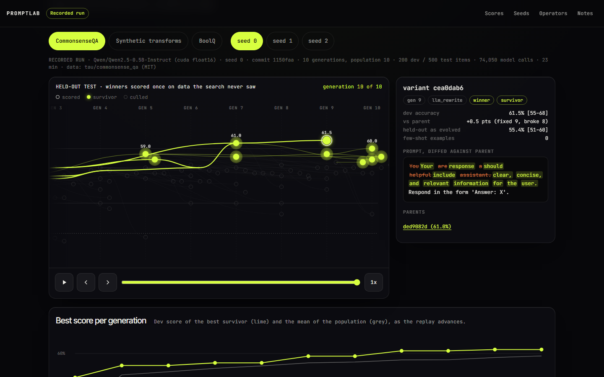
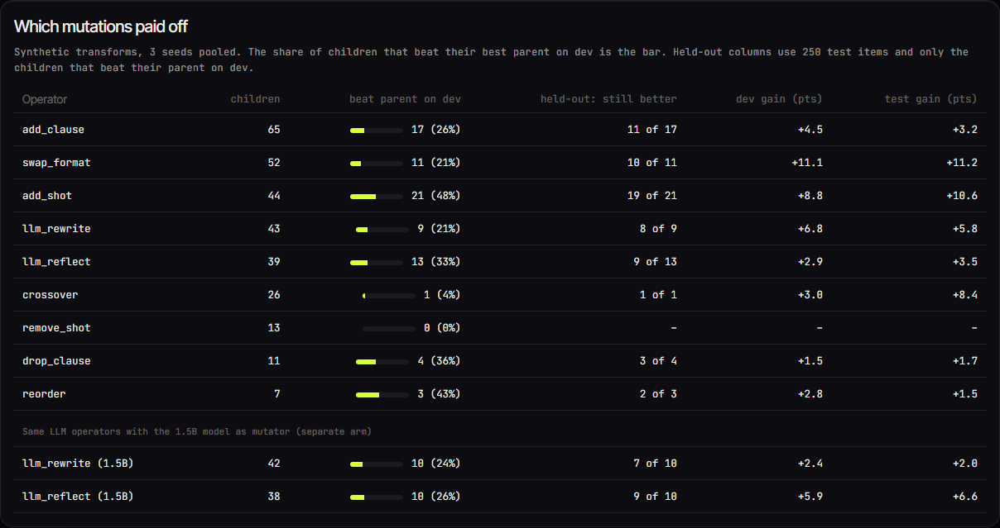
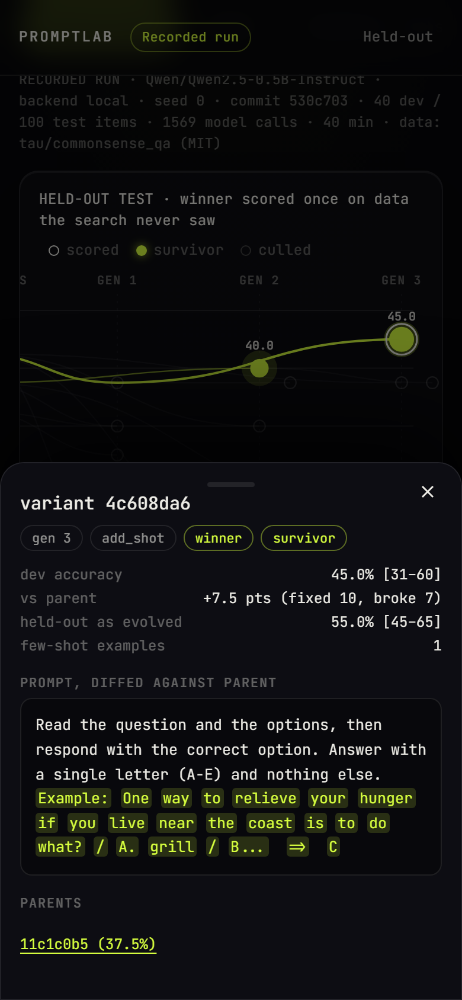
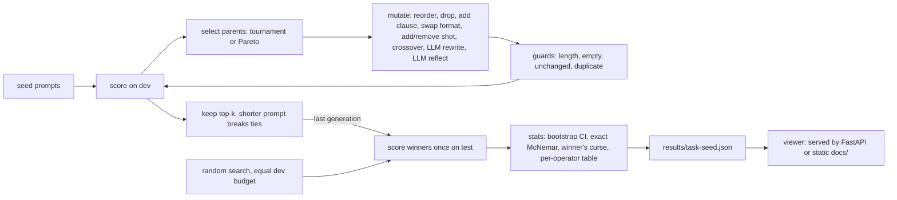

# PromptLab

Prompt engineering, treated as an optimisation problem. PromptLab keeps a population of prompt variants, mutates them, scores every variant on a dev split, keeps the strongest for the next generation, and finally scores the winners **once** on a held-out test split, next to a random-search baseline given exactly the same dev budget. Python, NumPy, a small local model, and an OpenAI-compatible adapter.

[](https://github.com/Aditya2616/PromptLab/actions/workflows/ci.yml)
[](LICENSE)

By [Aditya Jain](https://adityajain16.vercel.app) and [Sneha Singh](https://github.com/snehasingh2608).



The viewer replays real runs. Each column is a generation, each node a prompt variant, survivors glow lime, culled variants fade, curves link every child to its parent, and the best dev score climbs in step. Tap a node to see its prompt as a word diff against its parent, with its scores. Pick a task and a seed at the top. The page in `docs/` is a static replay of the recorded runs below (labelled "Recorded run", with seed, commit and device); run the server locally to launch a live run.

| Desktop | Phone (390 px) |
|---|---|
|  |  |

## How it works



- `models/`: a `ChatBackend` protocol, a local transformers backend (batched greedy generation; CUDA float16 when a GPU is available, otherwise CPU float32; out-of-memory retries with a smaller batch), an OpenAI-compatible client, and a SQLite call cache (key = hash of backend, model, device, dtype, messages and parameters) that makes runs reproducible and resumable.
- `tasks/`: CommonsenseQA, BoolQ and a seeded synthetic task (sort, nth word, count a letter), each with disjoint few-shot pool, dev and test splits.
- `operators.py`: deterministic operators edit a structured prompt (instruction sentences, format constraint, few-shot ids). Two LLM operators ask the mutator model to rewrite the instruction, or to reflect on three failed dev examples. A 0.5B model is a weak rewriter, so everything passes through guards.
- `select.py`: NumPy selection; Pareto parent choice works on per-example score vectors.
- `stats.py`, `summary.py`: Wilson and bootstrap intervals, paired bootstrap, exact McNemar, and the cross-seed aggregation that feeds the README and the viewer.
- `api.py`: FastAPI with `/health`, live runs streamed over SSE, and the static viewer.

## Read this before trusting any number

I built this to measure prompt search honestly, so the caveats come first.

- **The model is tiny.** Everything uses Qwen2.5-0.5B-Instruct. On a model this small, much of the gain is *output-format control*: it often knows the answer but replies in a shape the scorer rejects, so "reply with only the answer" is worth many points. That is a real effect, but it is not better reasoning.
- **Dev sets are noisy.** Even at a couple of hundred items the dev score has a standard error of several points, so some improvements during search are luck. That is what the held-out split is for.
- **The test split is touched once**, after the search finishes. `Task.test` raises while the loop runs, and a test asserts it. The winner's-curse gap (dev accuracy minus test accuracy of the prompt picked on dev) is reported for every method.
- **Random search at equal budget** is the control: same operators, no selection feedback, the same number of dev evaluations, best picked on dev. Evolution has to beat that, not just the seed prompt.
- **Seeds vary the search, not the data.** The seed prompts, the few-shot pool, the dev items and the test items are the same in every seed. Three seeds measure search-to-search variation; they do not measure how results would change on other data.
- **BoolQ has no headroom at this model size.** Its majority answer scores <!--v:boolq_majority_vs_first_draft-->4.6<!--/v--> points above the first-draft prompt, so there is little for any prompt search to find. I kept it, and say so, instead of hiding it.

## Results

Reproduce with `python scripts/run_experiments.py`, then `python scripts/check_numbers.py --write`. Every table in this section is generated from `results/*.json` by that script, and a fast test fails if the README is out of sync.

<!-- BEGIN setup -->
Task model Qwen/Qwen2.5-0.5B-Instruct, greedy decoding, cuda float16 for every run (recorded as `device` and `dtype` in each `results/*.json`). Per task and seed: 10 generations, population 10, 10 children per generation, 200 dev items, 500 held-out test items, 3 seeds (0, 1, 2). Evolution scored 100 children on dev and the random-search baseline scored 100 candidates, so the dev-evaluation budget is equal. All 9 runs: 551,898 new model calls and 1.8 h of recorded wall time on one GPU; calls already in the cache when a run was resumed are not counted again.
<!-- END setup -->

Test accuracy, per seed and as mean and standard deviation over seeds. The interval resamples test items (10,000 bootstrap resamples) after averaging each item's outcome over seeds.

<!-- BEGIN headline -->
| Task | Prompt | Held-out test per seed (%) | Mean ± SD over seeds (%) | 95% CI, items resampled (%) | Test − dev, mean (pts) |
|---|---|---|---|---|---|
| CommonsenseQA | First-draft seed prompt | 38.2 / 38.2 / 38.2 | 38.2 ± 0.0 | 34.0 to 42.4 | -4.3 |
|  | Best seed prompt (picked on dev) | 45.6 / 45.6 / 45.6 | 45.6 ± 0.0 | 41.2 to 50.0 | -5.4 |
|  | Random-search winner (equal budget) | 54.4 / 55.2 / 54.0 | 54.5 ± 0.6 | 50.7 to 58.4 | -6.8 |
|  | **Evolved winner** | 55.4 / 54.0 / 54.2 | 54.5 ± 0.8 | 50.6 to 58.4 | -5.6 |
|  | Evolved winner, 1.5B mutator | 54.4 / 56.2 / 54.8 | 55.1 ± 0.9 | 51.3 to 58.9 | -5.2 |
| Synthetic transforms | First-draft seed prompt | 5.0 / 5.0 / 5.0 | 5.0 ± 0.0 | 3.2 to 7.0 | -2.5 |
|  | Best seed prompt (picked on dev) | 10.6 / 10.6 / 10.6 | 10.6 ± 0.0 | 8.0 to 13.4 | -6.4 |
|  | Random-search winner (equal budget) | 53.6 / 51.0 / 43.6 | 49.4 ± 5.2 | 45.9 to 52.9 | -1.1 |
|  | **Evolved winner** | 64.0 / 68.8 / 45.4 | 59.4 ± 12.4 | 55.8 to 62.9 | +2.7 |
|  | Evolved winner, 1.5B mutator | 58.6 / 60.8 / 57.4 | 58.9 ± 1.7 | 55.3 to 62.6 | -1.7 |
| BoolQ (majority answer 64.4%) | First-draft seed prompt | 59.8 / 59.8 / 59.8 | 59.8 ± 0.0 | 55.6 to 64.0 | -3.7 |
|  | Best seed prompt (picked on dev) | 59.8 / 59.8 / 59.8 | 59.8 ± 0.0 | 55.6 to 64.0 | -3.7 |
|  | Random-search winner (equal budget) | 65.4 / 64.8 / 65.4 | 65.2 ± 0.3 | 61.1 to 69.3 | -4.6 |
|  | **Evolved winner** | 65.4 / 64.0 / 63.8 | 64.4 ± 0.9 | 60.3 to 68.5 | -7.1 |
|  | Evolved winner, 1.5B mutator | 63.6 / 64.0 / 64.0 | 63.9 ± 0.2 | 59.7 to 68.0 | -7.5 |
<!-- END headline -->

Paired comparisons on the same test items. The first number is pooled over seeds (per item, the difference averaged over seeds, then a bootstrap over items); the per-seed columns show each seed's difference and its exact McNemar p-value.

<!-- BEGIN paired -->
| Task | Evolved winner minus | Mean difference (pts), 95% CI | Per seed (pts) | Exact McNemar p per seed | Seeds ahead / behind |
|---|---|---|---|---|---|
| CommonsenseQA | **random-search winner** | +0.0 [-1.7, +1.7] | +1.0 / -1.2 / +0.2 | 0.442 / 0.594 / 1.000 | 2 / 1 |
|  | best seed prompt | +8.9 [+5.1, +12.7] | +9.8 / +8.4 / +8.6 | <0.001 / <0.001 / <0.001 | 3 / 0 |
|  | first-draft seed prompt | +16.3 [+12.1, +20.5] | +17.2 / +15.8 / +16.0 | <0.001 / <0.001 / <0.001 | 3 / 0 |
|  | random-search winner (1.5B-mutator arm) | +0.6 [-1.2, +2.4] | +0.0 / +1.0 / +0.8 | 1.000 / 0.665 / 0.757 | 2 / 0 |
| Synthetic transforms | **random-search winner** | +10.0 [+6.6, +13.4] | +10.4 / +17.8 / +1.8 | <0.001 / <0.001 / 0.507 | 3 / 0 |
|  | best seed prompt | +48.8 [+44.9, +52.7] | +53.4 / +58.2 / +34.8 | <0.001 / <0.001 / <0.001 | 3 / 0 |
|  | first-draft seed prompt | +54.4 [+50.7, +58.1] | +59.0 / +63.8 / +40.4 | <0.001 / <0.001 / <0.001 | 3 / 0 |
|  | random-search winner (1.5B-mutator arm) | +9.5 [+7.1, +12.1] | +5.0 / +9.8 / +13.8 | 0.038 / <0.001 / <0.001 | 3 / 0 |
| BoolQ | **random-search winner** | -0.8 [-2.1, +0.4] | +0.0 / -0.8 / -1.6 | 1.000 / 0.644 / 0.215 | 0 / 2 |
|  | best seed prompt | +4.6 [+1.2, +8.0] | +5.6 / +4.2 / +4.0 | 0.003 / 0.033 / 0.033 | 3 / 0 |
|  | first-draft seed prompt | +4.6 [+1.2, +8.0] | +5.6 / +4.2 / +4.0 | 0.003 / 0.033 / 0.033 | 3 / 0 |
|  | random-search winner (1.5B-mutator arm) | -1.3 [-2.8, +0.1] | -1.8 / -0.8 / -1.4 | 0.049 / 0.644 / 0.230 | 0 / 3 |
<!-- END paired -->

What this says, plainly:

- Evolution clearly beats a careless first-draft prompt on CommonsenseQA and on the synthetic task, with intervals well above zero. Mostly this is format: the winners tell the model to reply with only the letter or the answer. <!-- claim:beats_first_draft -->
- **On CommonsenseQA and BoolQ it does not beat random search at equal budget**: the interval for evolved minus random search is centred on zero, in both tasks. <!-- claim:ties_random -->
- **On the synthetic task it does**: evolved is ahead of random search in all three seeds, and the pooled interval is above zero. <!-- claim:synthetic_ahead --> But the evolved arm is much less stable across seeds than random search, and in the last seed the difference is within noise, so three seeds on one dataset is a hint about where search helps, not a general result. <!-- claim:synthetic_spread -->
- **BoolQ has no headroom.** The first-draft prompt is below the majority-class rate, and evolution and random search both end up at about that rate and no higher. Their "gain" over the seed prompt is reaching the majority answer, not reading better. <!-- claim:boolq_no_headroom -->

<!-- BEGIN verdicts -->
- CommonsenseQA: evolved minus random search is +0.0 pts (95% CI -1.7 to +1.7), ahead in 2 of 3 seeds; the interval includes zero.
- Synthetic transforms: evolved minus random search is +10.0 pts (95% CI +6.6 to +13.4), ahead in 3 of 3 seeds; the interval is above zero.
- BoolQ: evolved minus random search is -0.8 pts (95% CI -2.1 to +0.4), ahead in 0 of 3 seeds; the interval includes zero.
<!-- END verdicts -->

**Null result where there is little to find, a win where there is more.** On CommonsenseQA and BoolQ the design can rule out differences larger than about 2 points on these two tasks (the setup above: a few hundred items per split, three seeds, and a baseline given exactly the same number of dev evaluations), and it still finds no difference from random search. My reading: with a 0.5B model the useful edits are few and mostly about output format; random edits find them as quickly as selection does, and the dev set is too noisy for selection to separate the next few points from luck. The synthetic task, where wording, demonstrations and format all matter and the seed prompts start near zero, is where chains of selected edits pull ahead. That explanation is a hypothesis; I did not run an experiment that isolates it.

### Winner's curse

<!-- BEGIN curse -->
Means over seeds; the gap is dev minus test of the prompt each method picked on dev.

| Task | Prompt | Dev (%) | Test (%) | Gap (pts) |
|---|---|---|---|---|
| CommonsenseQA | Best seed prompt (picked on dev) | 51.0 | 45.6 | +5.4 |
|  | Random-search winner (equal budget) | 61.3 | 54.5 | +6.8 |
|  | Evolved winner | 60.2 | 54.5 | +5.6 |
| Synthetic transforms | Best seed prompt (picked on dev) | 17.0 | 10.6 | +6.4 |
|  | Random-search winner (equal budget) | 50.5 | 49.4 | +1.1 |
|  | Evolved winner | 56.7 | 59.4 | -2.7 |
| BoolQ | Best seed prompt (picked on dev) | 63.5 | 59.8 | +3.7 |
|  | Random-search winner (equal budget) | 69.8 | 65.2 | +4.6 |
|  | Evolved winner | 71.5 | 64.4 | +7.1 |
<!-- END curse -->

The prompt picked on dev scores lower on test for every method on CommonsenseQA and BoolQ, and for the best seed and the random-search winner on the synthetic task: that is selection on a noisy set. <!-- claim:winners_curse --> On CommonsenseQA the gap is about the same for evolution and random search. On the synthetic task the evolved winners score higher on test than on dev on average, with a large spread between seeds, so I would not read anything into the sign there.

### Which mutations paid off

For each operator: how many children it produced, how many beat their best parent on dev, and how those did against that parent on the held-out items (the first part of the test split; a diagnostic computed after the search, never fed back).

<!-- BEGIN operators -->
**CommonsenseQA** (all 3 seeds pooled; held-out columns use the first 250 test items)

| Operator | Children | Beat parent on dev | Of those, beat parent on test | Mean gain on dev (pts) | Mean gain on test (pts) |
|---|---|---|---|---|---|
| `add_clause` | 65 | 11 (16.9%) | 7 (63.6%) | +1.2 | +1.5 |
| `add_shot` | 58 | 14 (24.1%) | 10 (71.4%) | +4.2 | +5.6 |
| `swap_format` | 58 | 11 (19.0%) | 9 (81.8%) | +5.7 | +7.5 |
| `llm_rewrite` | 50 | 13 (26.0%) | 7 (53.8%) | +1.0 | +0.5 |
| `crossover` | 24 | 7 (29.2%) | 5 (71.4%) | +1.9 | +0.9 |
| `llm_reflect` | 21 | 6 (28.6%) | 5 (83.3%) | +1.7 | +0.8 |
| `drop_clause` | 9 | 2 (22.2%) | 1 (50.0%) | +1.3 | -0.8 |
| `reorder` | 8 | 5 (62.5%) | 4 (80.0%) | +1.6 | +0.4 |
| `remove_shot` | 7 | 0 (0.0%) | - | - | - |

**Synthetic transforms** (all 3 seeds pooled; held-out columns use the first 250 test items)

| Operator | Children | Beat parent on dev | Of those, beat parent on test | Mean gain on dev (pts) | Mean gain on test (pts) |
|---|---|---|---|---|---|
| `add_clause` | 65 | 17 (26.2%) | 11 (64.7%) | +4.5 | +3.2 |
| `swap_format` | 52 | 11 (21.2%) | 10 (90.9%) | +11.1 | +11.2 |
| `add_shot` | 44 | 21 (47.7%) | 19 (90.5%) | +8.8 | +10.6 |
| `llm_rewrite` | 43 | 9 (20.9%) | 8 (88.9%) | +6.8 | +5.8 |
| `llm_reflect` | 39 | 13 (33.3%) | 9 (69.2%) | +2.9 | +3.5 |
| `crossover` | 26 | 1 (3.8%) | 1 (100.0%) | +3.0 | +8.4 |
| `remove_shot` | 13 | 0 (0.0%) | - | - | - |
| `drop_clause` | 11 | 4 (36.4%) | 3 (75.0%) | +1.5 | +1.7 |
| `reorder` | 7 | 3 (42.9%) | 2 (66.7%) | +2.8 | +1.5 |

**BoolQ** (all 3 seeds pooled; held-out columns use the first 250 test items)

| Operator | Children | Beat parent on dev | Of those, beat parent on test | Mean gain on dev (pts) | Mean gain on test (pts) |
|---|---|---|---|---|---|
| `add_clause` | 66 | 8 (12.1%) | 3 (37.5%) | +1.9 | -0.1 |
| `add_shot` | 57 | 3 (5.3%) | 2 (66.7%) | +1.3 | +0.1 |
| `swap_format` | 57 | 11 (19.3%) | 11 (100.0%) | +3.6 | +2.9 |
| `llm_rewrite` | 52 | 4 (7.7%) | 1 (25.0%) | +1.5 | -0.9 |
| `crossover` | 25 | 5 (20.0%) | 3 (60.0%) | +1.6 | +0.2 |
| `llm_reflect` | 22 | 2 (9.1%) | 2 (100.0%) | +1.3 | +2.0 |
| `reorder` | 11 | 2 (18.2%) | 1 (50.0%) | +1.5 | +1.0 |
| `drop_clause` | 10 | 4 (40.0%) | 3 (75.0%) | +0.7 | +1.2 |
<!-- END operators -->

Format and demonstration edits (`swap_format`, `add_shot`) are the most productive and the most reliable: on the synthetic task `add_shot` beats its parent on dev far more often than either LLM operator, and almost all of those still hold up on test. <!-- claim:format_ops --> The LLM rewrite and reflect operators, run by a 0.5B model, are the weakest and least reliable. The mean gains are over the children that beat their parent, so selection inflates them, which is why the held-out columns matter.

### Stronger mutator (optional arm)

The LLM operators (rewrite, reflect on failures) normally ask the 0.5B task model itself. The optional arm evolves again with Qwen2.5-1.5B-Instruct as the mutator for those two operators only; the 0.5B model stays the task model and scores everything.

<!-- BEGIN operators_alt -->
**CommonsenseQA**: LLM-operator children, 0.5B mutator (main arm) vs 1.5B mutator

| Operator | Mutator | Children | Beat parent on dev | Mean gain on dev (pts) |
|---|---|---|---|---|
| `llm_rewrite` | 0.5B | 50 | 13 (26.0%) | +1.0 |
| `llm_rewrite` | 1.5B | 54 | 11 (20.4%) | +2.0 |
| `llm_reflect` | 0.5B | 21 | 6 (28.6%) | +1.7 |
| `llm_reflect` | 1.5B | 40 | 7 (17.5%) | +2.1 |

**Synthetic transforms**: LLM-operator children, 0.5B mutator (main arm) vs 1.5B mutator

| Operator | Mutator | Children | Beat parent on dev | Mean gain on dev (pts) |
|---|---|---|---|---|
| `llm_rewrite` | 0.5B | 43 | 9 (20.9%) | +6.8 |
| `llm_rewrite` | 1.5B | 42 | 10 (23.8%) | +2.4 |
| `llm_reflect` | 0.5B | 39 | 13 (33.3%) | +2.9 |
| `llm_reflect` | 1.5B | 38 | 10 (26.3%) | +5.8 |

**BoolQ**: LLM-operator children, 0.5B mutator (main arm) vs 1.5B mutator

| Operator | Mutator | Children | Beat parent on dev | Mean gain on dev (pts) |
|---|---|---|---|---|
| `llm_reflect` | 0.5B | 22 | 2 (9.1%) | +1.3 |
| `llm_reflect` | 1.5B | 52 | 2 (3.8%) | +1.0 |
| `llm_rewrite` | 0.5B | 52 | 4 (7.7%) | +1.5 |
| `llm_rewrite` | 1.5B | 51 | 12 (23.5%) | +1.6 |
<!-- END operators_alt -->

The first, much smaller experiments (CPU, 3 generations, 40 dev items, one seed) are kept for reference in [`results/pilot/`](results/pilot/README.md). They are not mixed into any table above.

## Quickstart

```bash
git clone https://github.com/Aditya2616/PromptLab && cd PromptLab
python -m venv .venv
. .venv/bin/activate                      # Windows: .venv\Scripts\activate
pip install -e ".[dev]"
pytest && ruff check .                    # fast, offline, CPU, scripted backend only

promptlab serve                           # viewer at http://127.0.0.1:8103
promptlab run --task synthetic --backend fake --generations 3   # instant, no model download
```

## Reproduce

To reproduce the recorded runs you also need the local backend and a GPU (a CPU works but is far slower):

```bash
pip install -e ".[local]"                 # torch and transformers
python scripts/run_experiments.py         # 3 tasks x 3 seeds; downloads the two models and the datasets
python scripts/check_numbers.py --write   # regenerate the README tables and docs/data from results/
pip install -e ".[ui]" && playwright install chromium
python scripts/check_ui.py --shots docs/assets   # headless check of the viewer, served and static, plus screenshots
```

`scripts/run_experiments.py` takes task names and `--seeds` to run a subset, `--device`/`--dtype` to override the automatic choice, and skips result files that already exist; the call cache in `runs/` lets an interrupted run resume. The `fake` backend is a deterministic simulator for tests and a quick look at the live panel. It is not a model, and none of the numbers above come from it.

## Backends: what was really exercised

- **Local transformers, Qwen2.5-0.5B-Instruct as the task model: used for every recorded result, on CUDA in float16** (also recorded as `device` and `dtype` in each result file). Device and dtype are part of the cache key and the cache file name, so a run never mixes completions from different numerics. Qwen2.5-1.5B-Instruct was used only as the mutator in the optional arm.
- **OpenAI-compatible client: adapter code, tested only against a stub HTTP transport** (`httpx.MockTransport`). I did not call a hosted API. Set `PROMPTLAB_BACKEND=openai`, `OPENAI_API_KEY`, `OPENAI_BASE_URL` and `PROMPTLAB_MODEL` (see `.env.example`); a local llama.cpp, vLLM or Ollama server works as the base URL.
- **The fast tests and the quickstart use the scripted `fake` backend on the CPU**; nothing in them needs torch.

## Layout

```
src/promptlab/   core: evolve.py, operators.py, select.py, stats.py, summary.py, pipeline.py, api.py, cli.py
  models/        ChatBackend protocol, local transformers backend, OpenAI-compatible client, call cache, scripted fake
  tasks/         CommonsenseQA, BoolQ, seeded synthetic task
scripts/         run_experiments.py, check_numbers.py (README and viewer data from results/), check_ui.py
results/         one JSON per task and seed; results/pilot/ holds the small CPU pilot
docs/            static viewer (index.html, app.js, style.css), data/ it reads, notes/, assets/
tests/           fast offline tests
```

## Static demo

The page in `docs/` is a self-contained replay of the recorded runs, labelled "Recorded run" with seed, commit and device. There is no hosted copy yet; the `docs/` folder can be served by GitHub Pages, or locally with `python -m http.server --directory docs`. Run `promptlab serve` for the live panel.

## Limitations

- One small model, three tasks, three seeds. The seeds share data, so they do not capture data variation.
- BoolQ has no headroom for this model; it is included for completeness.
- The dev winner is chosen by accuracy with a shorter-prompt tie-break; there is no regularisation against overfitting dev beyond the final held-out check.
- All methods are scored on the same test items (this is what makes the paired tests valid), and only after the search has ended. The per-operator held-out columns use a part of that same test split, after the arms are fixed, as a diagnostic only.
- Random search uses the same operators as evolution without `llm_reflect` (which needs scores), so the two spend slightly different numbers of mutator-model calls; the dev-evaluation budget, which dominates the cost, is equal.
- Not run: a SmolLM2 transfer check, other model sizes as the task model.

## Design notes

`docs/notes/RESEARCH.md` (related work: APE, OPRO, EvoPrompt, PromptBreeder, MIPROv2, TextGrad, GEPA; model and dataset licences) and `docs/notes/SPEC.md`.

## Credits and licences

Code: MIT, copyright Aditya Jain. Models: Qwen2.5-0.5B-Instruct and Qwen2.5-1.5B-Instruct (Apache-2.0, checked on the model cards). Data: CommonsenseQA via `tau/commonsense_qa` (MIT) and BoolQ via `google/boolq` (CC BY-SA 3.0), downloaded by script and not committed; the synthetic task is generated by this repo. Viewer fonts from Google Fonts (Inter Tight, Instrument Serif, JetBrains Mono).

## Authors

- [Aditya Jain](https://github.com/Aditya2616)
- [Sneha Singh](https://github.com/snehasingh2608)

Built by [Aditya Jain](https://adityajain16.vercel.app) and [Sneha Singh](https://github.com/snehasingh2608).
