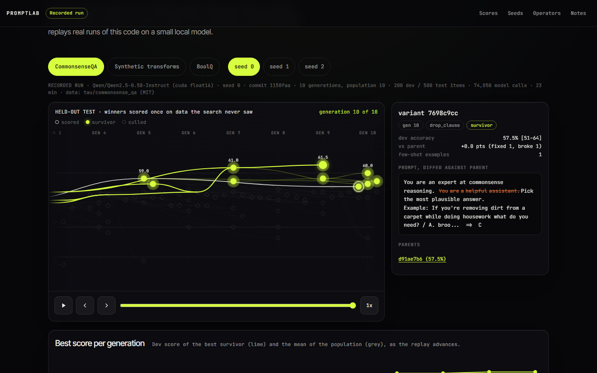
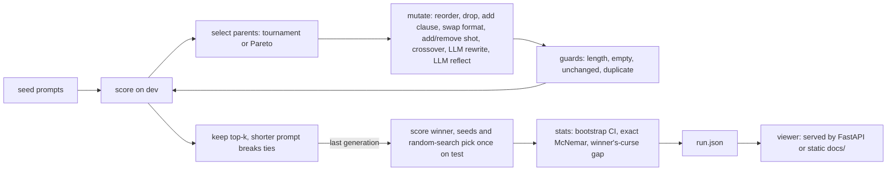

# PromptLab

Prompt engineering, treated as an optimisation problem. PromptLab keeps a population of prompt variants, mutates them, scores every variant on a dev split, keeps the strongest, and finally scores the winner **once** on a held-out test split. Python, NumPy, a small local model, and an OpenAI-compatible adapter.


The viewer replays real runs: each column is a generation, each node a prompt variant, survivors glow lime, weaker variants fade, and the best dev score climbs. Tap a node to see its prompt as a word diff against its parent. The page in `docs/` is a static replay of the recorded runs below (labelled "Recorded run", with seed and commit); run the server locally to launch a live run.

| Desktop | Phone (390 px) |
|---|---|
|  |  |

## Read this before trusting any number

I built this to measure prompt search honestly, so the caveats come first.

- **The model is tiny.** Everything below uses Qwen2.5-0.5B-Instruct on a CPU. On a model this small, much of the gain is *output-format control*: it often knows the answer but replies in a shape the scorer rejects, so "reply with only the answer" is worth many points. That is a real effect, but it is not better reasoning.
- **Dev sets are small and noisy.** 40 dev items means a standard error of about 8 points. Some improvements during search are luck.
- **The test split is touched once**, after the search finishes (100 items). `Task.test` raises while the loop runs, and a test asserts it. The winner's-curse gap (dev accuracy minus test accuracy of the dev winner) is stored for every arm.
- **Random search at equal budget** is the control: same operators, no selection feedback, same number of scored variants, best picked on dev.
- **One seed per task, small budgets.** Intervals are wide. Where evolution shows no significant gain, I report it as it is.

## Results (real runs, reproduce with `python scripts/run_experiments.py`)

Model Qwen2.5-0.5B-Instruct, greedy decoding, CPU, seed 0, 3 generations, population 4, 4 children per generation, 40 dev items, 100 test items. Every model call is cached in SQLite. The stored outputs are in `results/*.json`; each run was made at commit `530c703` with a clean tree and took 35 to 45 minutes. Test accuracy with 95% bootstrap CI (10,000 resamples).

| Task | First-draft seed | Best seed (picked on dev) | Random search, same budget | Evolved winner (dev / test) |
|---|---|---|---|---|
| CommonsenseQA | 34% [25-43] | 48% [38-58] | 55% [45-65] | 45% dev / **55%** [45-65] test |
| BoolQ (majority answer 67%) | 66% [57-75] | 71% [62-80] | 69% [60-78] | 65% dev / **70%** [61-79] test |
| Synthetic transforms | 7% [2-12] | 12% [6-19] | 36% [27-45] | 52.5% dev / **38%** [29-48] test |

Paired comparison of the evolved winner on test (exact McNemar):

| Task | vs first-draft seed | vs best seed | vs random search |
|---|---|---|---|
| CommonsenseQA | +21 pts, p = 0.001 | +7 pts, p = 0.25 | 0 pts, p = 1.0 |
| BoolQ | +4 pts, p = 0.57 | -1 pt, p = 1.0 | +1 pt, p = 1.0 |
| Synthetic | +31 pts, p < 0.001 | +26 pts, p < 0.001 | +2 pts, p = 0.86 |

What this says, plainly:

- Evolution clearly beats a careless first-draft prompt on CommonsenseQA and the synthetic task. Mostly this is format: the winners are the ones that tell the model to reply with only the letter or the answer.
- **It does not beat random search at equal budget** on any task here, and on CommonsenseQA and BoolQ it does not significantly beat the best hand-written seed. With about 12 scored children and a 40-item dev set, selection has very little signal. I would not claim evolution helped beyond what cheap random mutation finds.
- BoolQ shows no significant gain at all, and test accuracy sits close to the 67% majority-class rate. Published as is.
- The winner's curse is visible on the synthetic task: the winner scored 52.5% on dev and 38% on test, a 14.5 point gap. On CommonsenseQA test came out higher than dev, which at n = 40 is noise.

## How it works



- `models/`: a `ChatBackend` protocol, a local transformers backend (CPU, batched greedy), an OpenAI-compatible client, and a SQLite call cache (key = hash of backend, model, messages and parameters) that makes runs reproducible and resumable.
- `tasks/`: CommonsenseQA, BoolQ and a seeded synthetic task (sort, nth word, count a letter), each with disjoint few-shot pool, dev and test splits.
- `operators.py`: deterministic operators edit a structured prompt (instruction sentences, format constraint, few-shot ids). Two LLM operators ask the model to rewrite the instruction, or to reflect on three failed dev examples. A 0.5B model is a weak rewriter, so everything passes through guards.
- `select.py`: NumPy selection; Pareto parent choice works on per-example score vectors.
- `stats.py`: Wilson and bootstrap intervals, paired bootstrap, exact McNemar.
- `api.py`: FastAPI with `/health`, live runs streamed over SSE, and the static viewer.

## Quickstart

```bash
git clone https://github.com/Aditya2616/PromptLab && cd PromptLab
python -m venv --system-site-packages .venv
. .venv/bin/activate                      # Windows: .venv\Scripts\activate
pip install -e ".[dev]"
pip install torch transformers            # only needed for the local model backend
pytest && ruff check .                    # fast and offline

promptlab serve                           # viewer at http://127.0.0.1:8103
promptlab run --task synthetic --backend fake --generations 3   # instant, no download
python scripts/run_experiments.py         # the real runs: downloads ~1 GB model plus datasets, about 2 h on CPU
promptlab export-demo                     # copy results/*.json into docs/data for the static site
python scripts/make_screenshots.py        # headless Chromium at desktop and phone sizes
```

The `fake` backend is a deterministic simulator for tests and a quick look at the live panel. It is not a model, and none of the numbers above come from it.

## Backends: what was really exercised

- **Local transformers (Qwen2.5-0.5B-Instruct): used for every recorded result.**
- **OpenAI-compatible client: adapter code, tested only against a stub HTTP transport** (`httpx.MockTransport`). I did not call a hosted API. Set `PROMPTLAB_BACKEND=openai`, `OPENAI_API_KEY` and `OPENAI_BASE_URL` (see `.env.example`); a local llama.cpp, vLLM or Ollama server works as the base URL.

## Limitations

- Small scale: 40 dev and 100 test items, about 12 scored children per run, one seed, one model. The intervals are wide and the comparisons underpowered.
- Not run: a SmolLM2 transfer check, and multiple seeds.
- The dev winner is chosen by accuracy with a shorter-prompt tie-break; there is no regularisation against overfitting dev beyond the final held-out check.
- All arms of a run are scored on the same test items (this is what makes the paired tests valid), and only after the search has ended.

## Design notes

`docs/notes/RESEARCH.md` (related work: APE, OPRO, EvoPrompt, PromptBreeder, MIPROv2, TextGrad, GEPA; model and dataset licences) and `docs/notes/SPEC.md`.

## Credits and licences

Code: MIT, copyright Aditya Jain. Model: Qwen2.5-0.5B-Instruct (Apache-2.0). Data: CommonsenseQA via `tau/commonsense_qa` (MIT) and BoolQ via `google/boolq` (CC BY-SA 3.0), downloaded by script and not committed; the synthetic task is generated by this repo. Viewer fonts from Google Fonts (Inter Tight, Instrument Serif, JetBrains Mono).

Built by [Aditya Jain](https://adityajain16.vercel.app).
